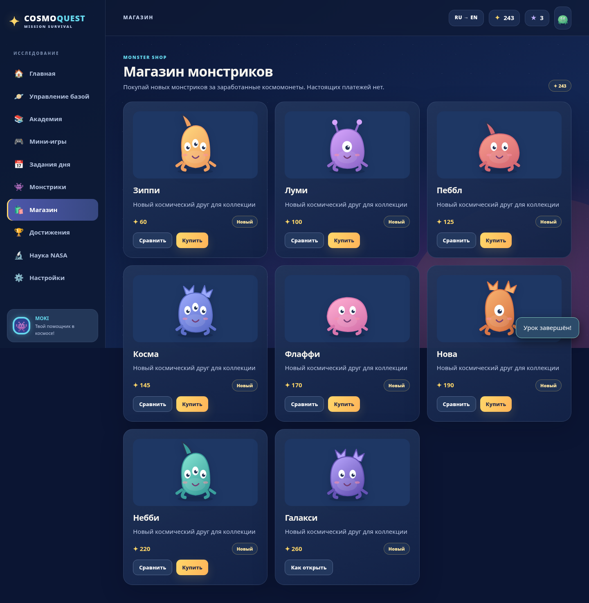

# COSMOQUEST: Mission Survival 🚀

**COSMOQUEST** is an interactive, browser-based 2D educational game for children aged 7–12. Players explore space science, make engineering decisions to keep a Martian research base running, and learn scientific concepts through short challenges and mini-games.



## Table of Contents
- [Features](#features)
- [Technology Stack](#technology-stack)
- [Installation and Launch](#installation-and-launch)
- [Environment Configuration](#environment-configuration)
- [Usage Examples](#usage-examples)
- [Project Structure](#project-structure)
- [Testing](#testing)
- [License](#license)

## Version 7: Usability and Button Audit

COSMOQUEST v7 fixes misleading or unhelpful UI actions. The glossary's **Details** dialog now works and contains contextual examples, related concepts, scheduled review status, and a direct link to the lesson. NASA science titles reveal genuinely new explanations and lead to relevant activities. Shop previews compare two different monsters and guide players to earn coins if they cannot afford an item. Mission Control's **Full Report** now includes the decisions and resource changes of every completed sol.

A wrong answer in the concept practice now requires another attempt rather than immediately exposing the answer. The daily learning challenge remains playable after all concepts are already learned; reviews count once per distinct concept per day. On-demand Cosmic Recall explanations reset for each question. Academy navigation, starter nickname preservation, and buttons that have nothing to reset were also corrected.

Run `node --check app.js`, `python test_v5.py`, `python test_v7.py`, `python test_persistence.py`, and `python test_standalone_v7.py` to repeat the included checks. The game itself requires **no** packages or backend.

## Features

- **Mars Mission Control:** Manage a research base over five Martian sols. Balance energy, oxygen, and crew safety, and see how each decision affects future resources.
- **Space Academy:** Learn 36 scientific concepts across six modules. Each lesson has five stages: introduction, multiple choice, matching, fill-in-the-gap, and error correction. Each module also includes a cumulative final challenge.
- **Spaced Repetition:** Review completed concepts on a simple 1-, 3-, 7-, 14-, or 30-day schedule based on practice results.
- **Six Mini-Games:** Play Cosmic Recall, Cosmic Relay, Power Master, Water Loop, Space Sort, and Mission Fix.
- **Expanded Cosmic Recall:** Answer open-ended questions from 37 categories, with 268 valid-answer groups and 797 accepted answer strings or variants. The game accepts Russian, English, and Kazakh answers.
- **Collectible Monsters:** Choose from 10 original space monsters. Two are free; eight can be unlocked using **Cosmo Coins** earned in the game. Purchases are cosmetic only.
- **Daily Challenges and Achievements:** Complete daily missions, earn XP and coins, unlock achievements, and track your progress.
- **NASA Science:** Explore educational cards linked to official NASA resources and optionally request recent space-weather records through the NASA DONKI API.
- **Three Languages:** Switch between **English, Russian, and Kazakh**. Science lessons explain concepts in the selected language rather than teaching a foreign language.
- **Accessibility and Offline Play:** Adjustable timers, reduced-motion options, high-contrast mode, larger text, keyboard-friendly controls, and local progress saving.

> **Scientific accuracy:** Mission resource percentages, scores, and other simulation values are educational game mechanics—not live NASA measurements. COSMOQUEST is an independent project and is not an official NASA application.

## Technology Stack

| Component | Technology |
| --- | --- |
| Languages | HTML5, CSS3, JavaScript (ES6+) |
| Framework | None — vanilla JavaScript |
| Graphics and animation | Inline SVG, CSS animations |
| Browser storage | `localStorage` with JSON export/import |
| External data | Optional NASA DONKI API using `fetch()` and the public `DEMO_KEY` |
| Backend and database | None required |
| Build tools | None required for playing the game |
| Optional testing tools | Python, Playwright, Chromium, Node.js for JavaScript syntax checks |

## Installation and Launch

### Requirements

- A modern browser such as **Chrome, Edge, Firefox, or Safari**.
- **No npm installation, backend server, database, or account** is required to play.
- Python 3 is optional if you want to run the multi-file version through a local development server.

### Option 1 — Play the Standalone Version

1. Download the project or its ZIP archive and extract it.
2. Open `COSMOQUEST_single.html` in your browser.
3. Start playing. The main experience works offline.

### Option 2 — Run the Editable Version

Keep `index.html`, `styles.css`, and `app.js` together in the same directory, then open `index.html` in your browser.

If your browser restricts local files, open a terminal in that directory and run:

```bash
python -m http.server 8000
```

Visit **http://localhost:8000/** in your browser.

### Option 3 — Clone a Git Repository

Once the project is published on GitHub, replace the placeholders below with its actual repository URL and directory:

```bash
git clone <YOUR_REPOSITORY_URL>
cd <YOUR_REPOSITORY_DIRECTORY>
```

Then open the standalone HTML file, or navigate to the folder containing `index.html` and use the local-server command above.

## Environment Configuration

No `.env` file or secret API key is required.

- **Language:** Select English, Russian, or Kazakh in the game settings.
- **Difficulty:** Choose Easy or Normal. The difficulty changes starting resources and selected timed challenges.
- **Sound and accessibility:** Configure sound effects, animations, timers, high contrast, and text size in Settings.
- **Saved progress:** Game data is stored in the current browser's `localStorage`. Use **Settings → Export/Import JSON** to make a backup or transfer progress manually.
- **NASA data:** The optional DONKI request uses the public NASA `DEMO_KEY`. The main game and built-in science cards remain available if the request fails or there is no internet connection.

## Usage Examples

### Complete a Mars Mission

Open **Mission Control**, start a five-sol mission, compare the resource forecasts for each choice, and try to complete the mission without exhausting essential supplies.

### Study in Space Academy

Open **Space Academy**, select a module, and complete the five-step lesson. Use **Next** to move directly to the following lesson. After finishing the six concepts in a module, unlock its final matching challenge. Return to **Scheduled Review** when concepts are due for practice.

### Play Cosmic Recall

Open **Mini Games → Cosmic Recall**. Answer seven open-ended space-science questions in your chosen language. Answers are checked against a local catalog, so an AI service and internet access are not needed.

### Collect a Monster

Earn Cosmo Coins through lessons and mini-games, open the **Monster Shop**, unlock a monster, and select it in your collection. Monsters do not change scientific scores or mission performance.

## Project Structure

```text
COSMOQUEST/
├── index.html                # Entry point for the editable version
├── styles.css                # Responsive layout and visual design
├── app.js                    # Game logic, localization, and embedded content
├── COSMOQUEST_single.html    # Standalone offline game
├── academy_questions.json    # Editor-friendly data for 36 lessons
├── sync_gap_from_json.py     # Sync edited gap prompts into app.js
├── build_academy_data.py     # Export lesson data from app.js to JSON
├── test_v5.py                # Browser regression tests
├── test_bundle_v5.py         # Standalone-file and save migration tests
├── test_answers.py           # Cosmic Recall answer checks
├── test_persistence.py       # Saving and reward tests
├── academy-preview-v5.png    # Lesson introduction screenshot
├── academy-matching-v5.png   # Matching activity screenshot
├── academy-review-v5.png     # Error-correction screenshot
├── academy-next-v5.png       # Next-lesson screen screenshot
└── README.md                 # Project documentation
```

**Note:** `academy_questions.json` is provided for easier content editing. The currently playable game loads its lesson data from `app.js`; it does **not** automatically fetch the JSON file. After editing gap prompts, run `python sync_gap_from_json.py` and rebuild the standalone version according to the project scripts.

## Testing

For a JavaScript syntax check (Node.js is only needed for this optional command):

```bash
node --check app.js
```

The project also includes browser-based regression tests. To run them, install Python Playwright and a compatible Chromium browser, then run:

```bash
python test_v5.py
python test_bundle_v5.py
python test_answers.py
python test_persistence.py
```

Version 5 was tested for lesson flow, localization, save compatibility, rewards, and responsive layouts. Automated tests cannot guarantee the absence of all bugs; check direct opening of the standalone HTML on the target demonstration device.

## License

**No license has been specified for this repository yet.** Add a `LICENSE` file before publishing the project for reuse or distribution under a particular open-source license.

NASA resources are attributed to their original sources. COSMOQUEST is independently developed and is **not affiliated with or endorsed by NASA**.
